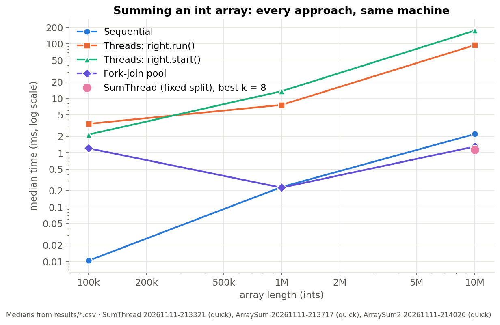
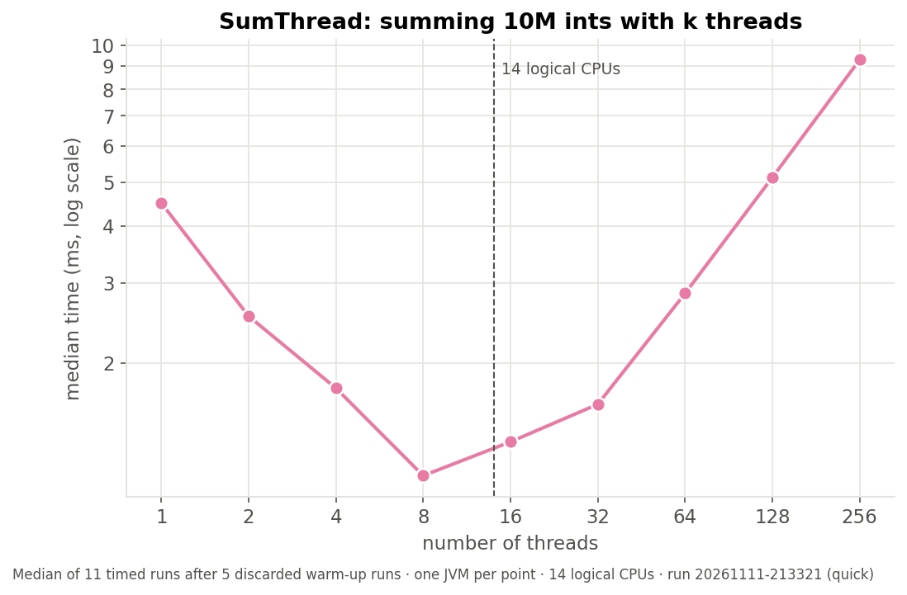
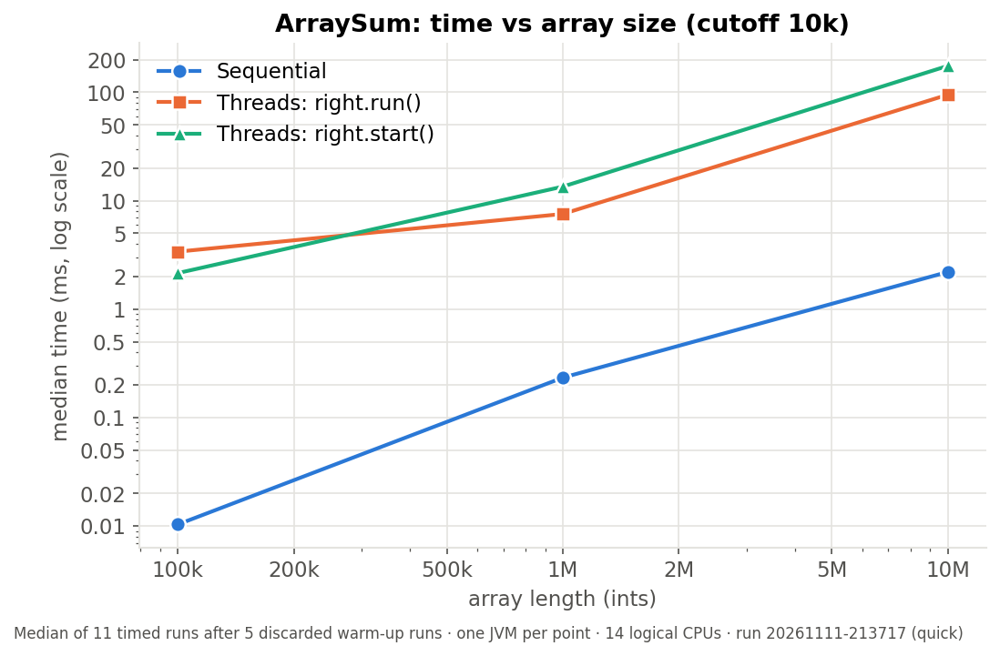
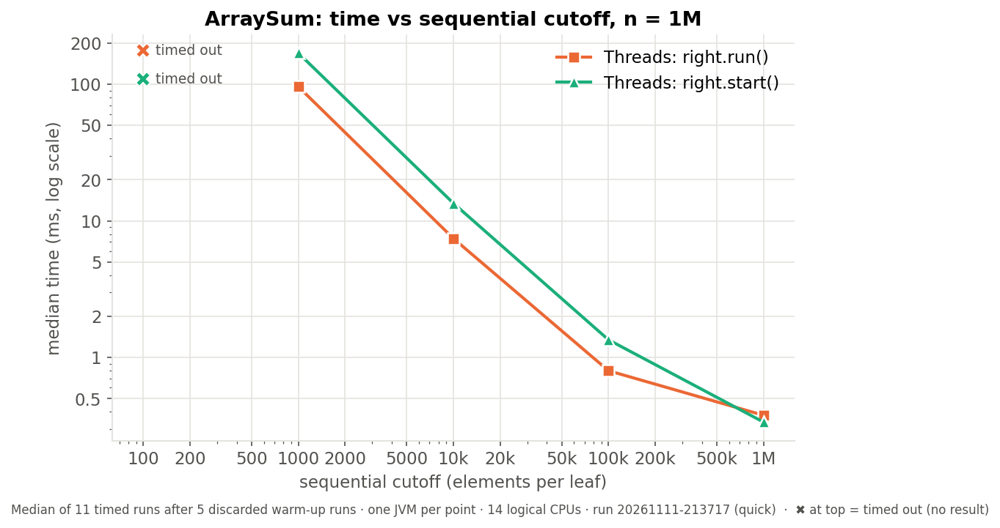
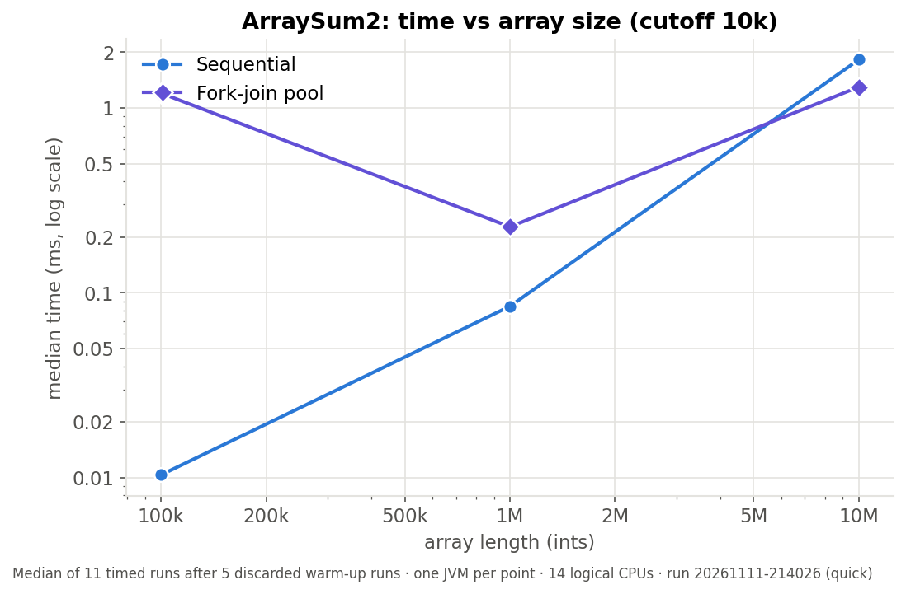
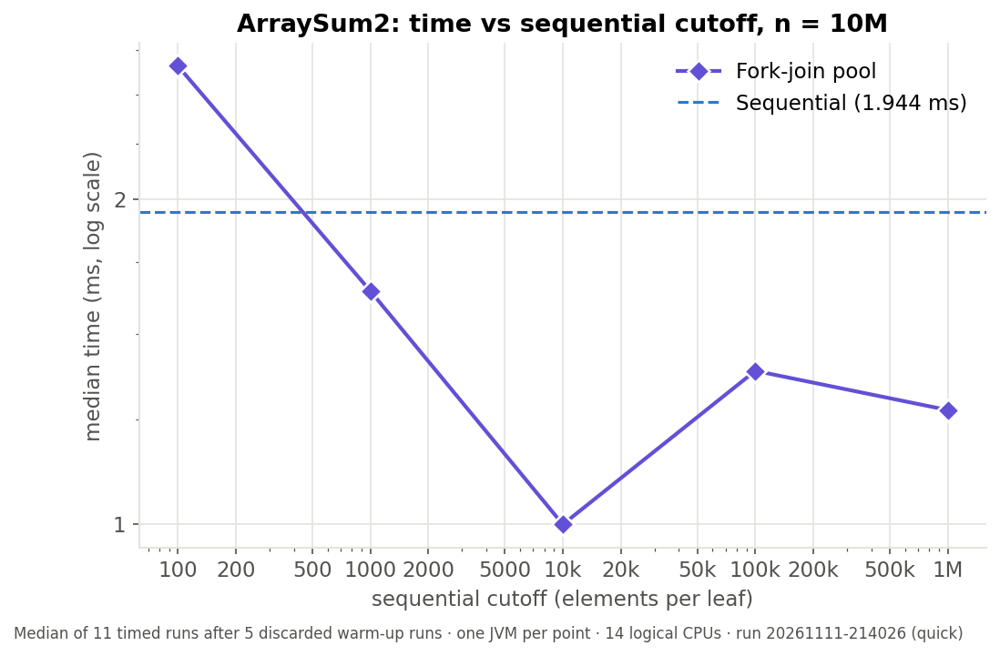
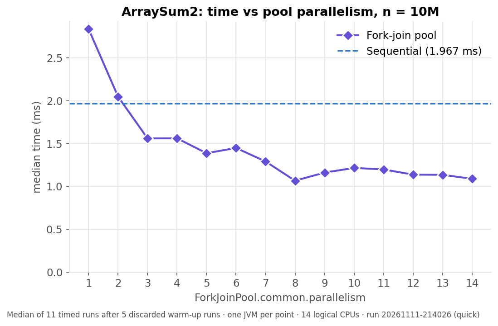

# Parallel array sum: threads vs. fork-join — benchmark findings

Results from running `demo.sh` on the three fork-join lecture examples
(`SumThread.java`, `ArraySum.java`, `ArraySum2.java`). All numbers below come
from `results/*.csv`; all figures are in `figures/` and can be regenerated
without re-running anything (`./demo.sh <Program>.java --plot-only`).

## Setup

| | |
|---|---|
| Machine | Intel Core Ultra 7 165U, 14 logical CPUs (2 P-cores with Hyper-Threading, 8 E-cores, 2 low-power E-cores), 12 MiB L3, 30 GB RAM |
| JVM | OpenJDK 21.0.13, default flags, one fresh JVM per data point |
| Method | 5 warm-up runs (discarded), then the **median of 11 timed runs**; 5 s timeout per point |
| Preset | `--quick` (the default) |
| Runs | SumThread `20261111-213321`, ArraySum `20261111-213717`, ArraySum2 `20261111-214026` |

The workload is summing an `int[]`, which is close to the least work you can
do per element. A 10M-element array (40 MB) does not fit in the 12 MiB L3,
so every run streams from main memory. That makes overhead and memory
bandwidth, rather than arithmetic, the dominant costs throughout.

## Summary

1. **Fixed split (SumThread):** speedup peaks at **8 threads (3.98×)**, then
   falls. By 256 threads the program is 2× *slower* than with one thread,
   because each thread costs about 35 µs to create and there are only 14
   logical CPUs to run them.
2. **Divide-and-conquer with one OS thread per task (ArraySum):** the
   algorithm is right, but it is **32–330× slower than a plain loop** at
   every size tested. It creates hundreds to thousands of threads at
   50–95 µs each to do about 2 ms of work. Smaller cutoffs make it worse;
   at cutoff 100 it does not finish at all.
3. **The same algorithm on `ForkJoinPool` (ArraySum2):** **73× faster than
   ArraySum** at 10M, and the only recursive version that beats sequential.
   It tolerates a wide range of cutoffs and still copes with 131K tasks.
4. **Ceiling:** the best fork-join time (≈1.07 ms) and the best hand-tuned
   SumThread time (1.13 ms) at 10M are nearly identical, about 37 GB/s of
   data read. Both appear to be limited by **memory bandwidth**, not by the
   threading mechanism, which caps speedup near 2× here rather than 14×.



| At n = 10M | median time | vs sequential |
|---|---|---|
| Sequential loop | 1.82–2.20 ms | 1× |
| ArraySum, `right.run()` (cutoff 10k) | 94.9 ms | 43× slower |
| ArraySum, `right.start()` (cutoff 10k) | 175.1 ms | 80× slower |
| SumThread, 8 threads (fixed split) | 1.13 ms | 1.6–1.9× faster |
| ArraySum2, fork-join (cutoff 10k) | 1.30 ms | 1.4× faster |

(The sequential time varies between JVMs; see [Caveats](#caveats).)

## 1. SumThread — time vs number of threads

Fixed array of 10M ints split into `k` equal slices, one `Thread` per slice.



| threads | 1 | 2 | 4 | **8** | 16 | 32 | 64 | 128 | 256 |
|---|---|---|---|---|---|---|---|---|---|
| median (ms) | 4.50 | 2.54 | 1.76 | **1.13** | 1.34 | 1.62 | 2.85 | 5.12 | 9.30 |
| vs 1 thread | 1.00× | 1.77× | 2.55× | **3.98×** | 3.35× | 2.77× | 1.58× | 0.88× | 0.48× |

**Why it falls (1 → 8 threads).** Each thread sums `n/k` elements
concurrently, so the work per thread shrinks as `T₁/k`. The speedup is
sub-linear (4× from 8 threads) for two reasons:

- the sum is limited by how fast memory delivers data, so extra cores help
  only until memory can't keep up;
- `sum()` gives every thread an identical slice and then `join()`s them all,
  so total time is set by the slowest thread. On a hybrid P/E-core CPU,
  slices that land on E-cores or low-power E-cores hold everyone up.

**Why it rises (past 8–16 threads).** Every thread is a real OS thread,
created one at a time by `main`. Past the minimum, time grows almost exactly
in proportion to `k`:

| | added time | per extra thread |
|---|---|---|
| 64 → 128 threads | +2.28 ms | ≈ 36 µs |
| 128 → 256 threads | +4.17 ms | ≈ 33 µs |

At 256 threads each thread sums only 39K ints (≈ 18 µs of work at the
single-thread rate), so starting it costs more than the work it does. Beyond
14 threads there is also no spare hardware; the extra threads just take
turns on the same CPUs.

**A model for the classroom:** `T(k) ≈ T₁/k + c·k` with T₁ ≈ 4.5 ms and
c ≈ 0.034 ms has its minimum at `k = √(T₁/c) ≈ 11`, between the measured 8
and 16. The observed minimum is a little lower because memory bandwidth and
the slow cores make threads beyond ~8 worth less than the model assumes.

## 2. ArraySum — divide-and-conquer with a new thread per task

Recursive halving until a range is shorter than `sequentialCutoff`. Each
split calls `left.start()`, then either `right.run()` (same-thread mode) or
`right.start()` (separate-threads mode).

### (a) Time vs array size (cutoff 10k)



| n | leaf tasks | sequential | `right.run()` | `right.start()` |
|---|---|---|---|---|
| 100k | 16 | 0.010 ms | 3.39 ms | 2.15 ms |
| 1M | 128 | 0.233 ms | 7.55 ms | 13.49 ms |
| 10M | 1,024 | 2.20 ms | 94.9 ms | 175.1 ms |

Both threaded versions lose to the sequential loop at every size, by 32×
(1M, `run()`) up to about 330× (100k, `run()`). At 10M, same-thread mode
starts 1,023 threads and separate-threads mode starts 2,046. Dividing time
by threads gives **≈ 86–93 µs per thread** at 10M (≈ 53–59 µs at 1M). The
cost per thread rises with the count, as more threads sit alive and blocked
in `join()` at the same time.

**`right.run()` vs `right.start()`.** At 1M and 10M, same-thread mode is
about **1.8× faster** because it creates half as many threads. The parent
would otherwise idle in `join()`, so it does the right half itself. At 100k,
with only 16 leaves, the order flips, which is within run-to-run noise. The
same reasoning explains the "don't move this up a line" comment: calling
`left.join()` before `right.run()` would make the halves run one after the
other.

### (b) Time vs sequential cutoff (n = 1M)



| cutoff | leaf tasks | `right.run()` | `right.start()` |
|---|---|---|---|
| 1M | 2 | 0.38 ms | 0.34 ms |
| 100k | 16 | 0.80 ms | 1.35 ms |
| 10k | 128 | 7.43 ms | 13.45 ms |
| 1k | 1,024 | 95.9 ms | 169.2 ms |
| 100 | 16,384 | **timed out** (> 5 s for 16 runs) | **timed out** |

Time grows with the number of threads, and at about 16K threads neither mode
completes. The best setting, cutoff = n (barely parallel at all), is still
1.4–1.6× slower than the plain loop (0.233 ms). This is the trap with raw
threads: small tasks spread the work evenly across cores, but every task
costs a thread. You can't have both.

## 3. ArraySum2 — the same algorithm on `ForkJoinPool`

`SumArray extends RecursiveTask<Long>`; `left.fork()`, `right.compute()`,
`left.join()`, invoked on the common pool.

### (a) Time vs array size (cutoff 10k, common-pool parallelism 13)



| n | sequential | fork-join | speedup |
|---|---|---|---|
| 100k | 0.010 ms | 1.20 ms | 0.01× |
| 1M | 0.084 ms | 0.227 ms | 0.37× |
| 10M | 1.82 ms | 1.30 ms | **1.40×** |

Fork-join has a fixed overhead of roughly 0.2–1 ms per call (waking pool
workers and scheduling the first tasks), so it **only pays off once the array
is large enough**. Here the crossover is between 1M and 10M. (An earlier
quick run measured 0.36 ms at 100k and 2.13× at 10M; small-n and speedup
numbers are the noisiest in the data.) Against ArraySum at the same cutoff,
fork-join is **33× faster at 1M and 73× faster at 10M**.

### (b) Time vs sequential cutoff (n = 10M)



| cutoff | leaf tasks | fork-join |
|---|---|---|
| 1M | 16 | 1.27 ms |
| 100k | 128 | 1.39 ms |
| 10k | 1,024 | **1.00 ms** |
| 1k | 16,384 | 1.64 ms |
| 100 | 131,072 | 2.66 ms |
| *sequential (median across these JVMs)* | | *1.94 ms* |

- **The cutoff is forgiving.** Every cutoff from 1k to 1M lands within 1.6×
  of the best, and the best moved between runs (100k in an earlier run, 10k
  in this one). The curve is flat across that whole range.
- **Too small still costs.** At cutoff 100 the 131K tasks take 2.66 ms,
  slower than sequential. But compare ArraySum, where **16K threads did not
  finish in 5 s**: a fork-join task costs nanoseconds, a thread tens of µs.
- The usual textbook cutoff of about 500–1000 is on the low side for this
  workload, because adding one int is so cheap that each task needs many
  elements to be worth scheduling.

### (c) Time vs pool parallelism (n = 10M, cutoff 10k)

Set with `-Djava.util.concurrent.ForkJoinPool.common.parallelism=N`.



| parallelism | 1 | 2 | 3 | 4 | 5 | 6 | 7 | 8 | 9–14 |
|---|---|---|---|---|---|---|---|---|---|
| fork-join (ms) | 2.84 | 2.05 | 1.56 | 1.56 | 1.39 | 1.45 | 1.29 | 1.07 | 1.09–1.22 |

Sequential (median across these 14 JVMs): 1.96 ms.

- **One worker is slower than sequential** (2.84 vs 1.96 ms). You pay for
  recursion and task objects and get no parallelism back.
- **Time levels off from about 8 workers at ≈ 1.1 ms**, a ≈ 1.8× speedup.
  40 MB in 1.07 ms is about 37 GB/s of data read. SumThread's best (1.13 ms
  with 8 hand-made threads) reaches almost the same time through a completely
  different mechanism. That points to memory bandwidth as the shared limit,
  with the slower E-cores contributing less beyond the first few workers.
- Differences of about 20% between neighbouring points are noise.

## Takeaways for the lecture

| Approach | Best at 10M | What limits it |
|---|---|---|
| Sequential loop | ≈ 2 ms | one core |
| SumThread (fixed split) | 1.13 ms (8 threads) | choosing `k` by hand; thread cost past ~8–16 threads |
| ArraySum (thread per task) | 94.9 ms (`right.run()`) | the cost of creating OS threads |
| ArraySum2 (fork-join) | 1.00–1.30 ms | memory bandwidth |

1. **Parallelism pays only when each unit of work is much larger than the
   cost of scheduling it.** OS threads cost tens of µs; this workload does
   about 0.2 ns of work per element.
2. **Divide-and-conquer needs cheap tasks.** With threads, a fine split is
   ruinous (ArraySum). With a work-stealing pool, the same split costs
   almost nothing (ArraySum2), so you get load balancing without hand-tuning.
3. **Don't spawn work you'd otherwise wait for.** `right.run()` beats
   `right.start()` by about 1.8×; `compute()` on the right half in
   ArraySum2 is the same idea.
4. **Fork-join matches a hand-tuned fixed split** without choosing a thread
   count, and keeps working across cutoffs and machines.
5. **Speedup is capped by the bottleneck resource, not the core count.**
   Summing is memory-bound, so 14 logical CPUs yield ≈ 2×. With more
   computation per element, the same code would scale much further.

## Caveats

- **Quick preset only.** These are `--quick` runs (sizes up to 10M, 11 timed
  runs). `--full` (up to 1e8, 15 runs, 300 dpi + PDF) has not been run end to
  end; expect it to take 20–30 minutes, dominated by ArraySum's
  separate-threads mode at 1e8 (≈ 12 s per run).
- **The sequential time is bimodal across JVMs**, clustering near 1.7–2.0 ms
  and 3.6–4.1 ms with identical parameters. The likely cause is the main
  thread landing on a P-core vs an E-core. Figures use the median across
  JVMs; per-row "speedup" columns in the live table are noisier than the
  plots.
- Speedups and small-n timings differ noticeably between quick runs (for
  example, ArraySum2 at 10M: 2.13× in one run, 1.40× in this one). The
  qualitative findings were the same in every run.
- Bandwidth figures (≈ 37 GB/s) are inferred from times and array size, not
  measured with a memory-bandwidth tool.

## Code changes made for these experiments

Only `main()`, the timing harness and `sum()`'s thread-count handling
changed; `run()`, `compute()` and the class structure are as on the slides.

1. `SumThread` is declared in both `SumThread.java` and `ArraySum.java`:
   resolved by compiling each program into its own `build/<Program>/`
   directory.
2. `ArraySum2` set `SumThread.sequentialCutoff`; now `SumArray.sequentialCutoff`.
3. Integer division `(endTime - startTime)/1000000` recorded sub-millisecond
   runs as 0; now `/ 1e6`.
4. The cutoff argument was ignored (hard-coded 10000); now parsed.
5. `SumThread.sum()` hard-coded 8 threads; now `sum(int[] arr, int numTs)`.
6. `SumThread.sum()` computed slice bounds as `i * len / numThreads` in
   `int`, which overflowed for 256 threads × 10M and silently produced a wrong
   sum; now computed in `long`.

Each `main()` also discards warm-up runs, reports the median, and exits with
an error if the parallel and sequential sums differ.

## Reproducing

```sh
./demo.sh SumThread.java      # ~3 s
./demo.sh ArraySum.java       # ~25 s
./demo.sh ArraySum2.java      # ~9 s
./demo.sh all                 # overlay from the CSVs, re-runs nothing
# --full for publication figures, --no-show to skip opening, --plot-only to re-plot
```
