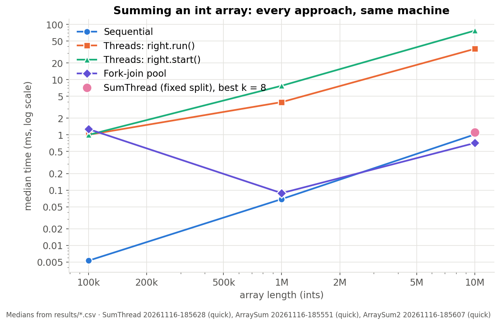
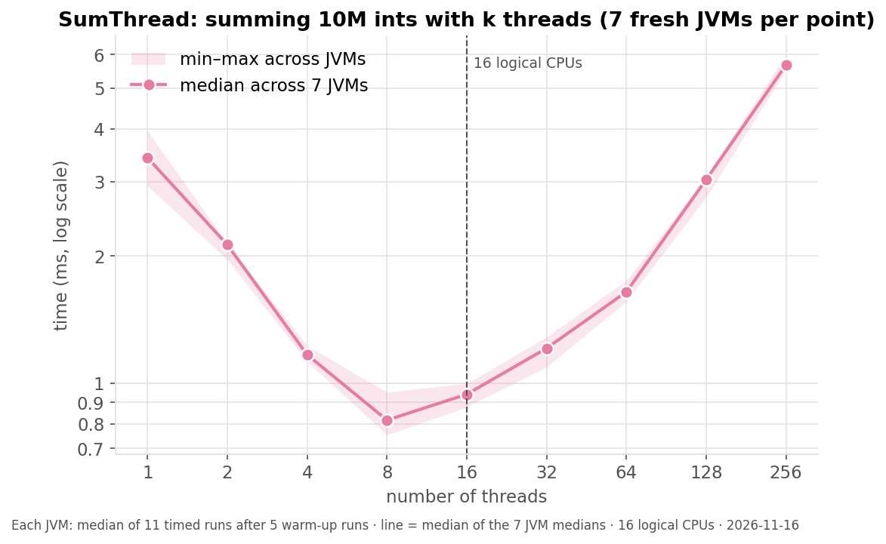
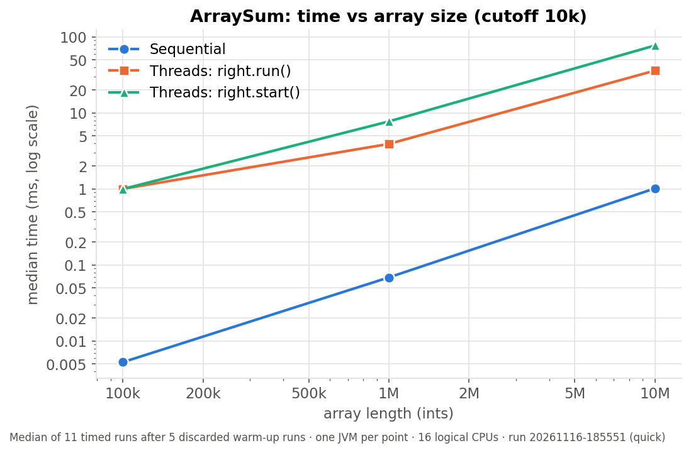
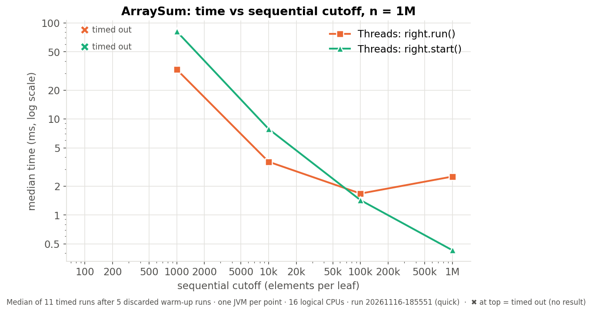
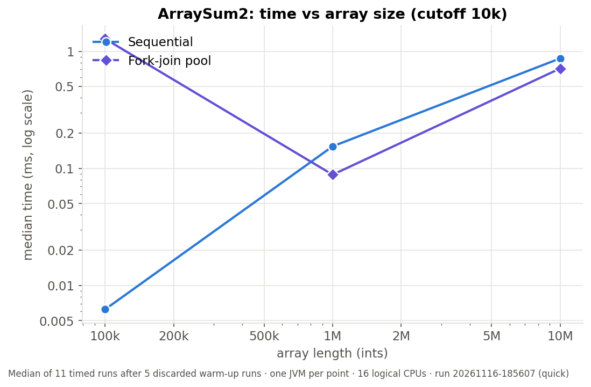
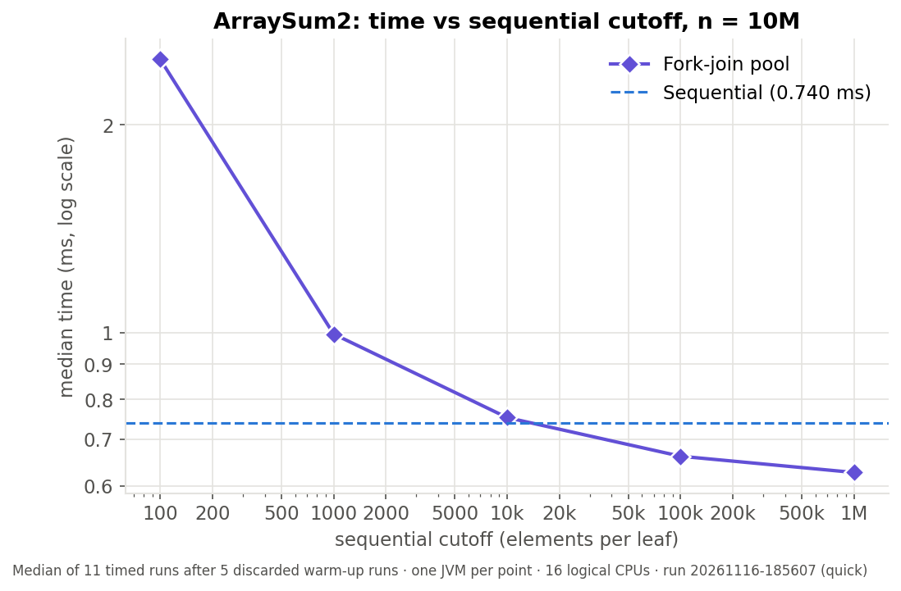
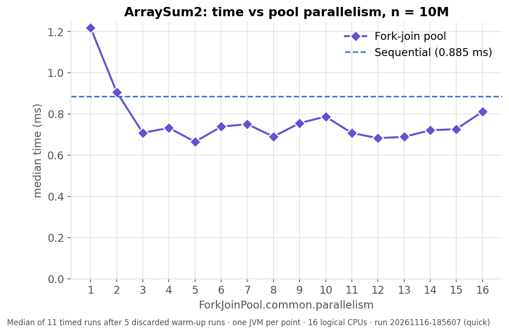

# Parallel array sum: threads vs. fork-join — benchmark findings

Results from running `demo.sh` on the three fork-join lecture examples
(`SumThread.java`, `ArraySum.java`, `ArraySum2.java`) on a new laptop
(AMD Ryzen AI 7 PRO 450). Unless noted, numbers come from `results/*.csv`
and figures from `figures/`; most figures can be regenerated without
re-running anything (`./demo.sh <Program>.java --plot-only`). An earlier
version of this report used an Intel Core Ultra 7 165U laptop; see
[Comparison with the previous laptop](#comparison-with-the-previous-laptop).

## Setup

| | |
|---|---|
| Machine | AMD Ryzen AI 7 PRO 450, 8 cores / 16 logical CPUs: 4 cores at up to 5.16 GHz and 4 compact cores at up to 3.63 GHz (per `lscpu`), 16 MiB L3, 19 GB RAM visible to Linux |
| OS / JVM | Linux 7.0, OpenJDK 21.0.13, default flags, one fresh JVM per data point |
| Method | 5 warm-up runs (discarded), then the **median of 11 timed runs**; 5 s timeout per point |
| Preset | `--quick` (the default) |
| Runs (2026-11-16) | SumThread `185515`, `185549`, `185628` plus a 7-JVM sweep (below); ArraySum `185521`, `185551`; ArraySum2 `185538`, `185607` |

Each program was run at least twice. The figures and tables show the **latest
run** unless they say otherwise, and differences between runs are called out
where they matter. SumThread was too noisy for single runs, so its section uses
a separate sweep with 7 fresh JVMs per thread count
(`results/SumThread_7jvm.txt`, figure `figures/SumThread_threads_7jvm.png`).

The workload is summing an `int[]`, which is close to the least work you can
do per element. A 10M-element array (40 MB) does not fit in the 16 MiB L3, so
every run streams from main memory. That makes overhead and memory bandwidth,
rather than arithmetic, the dominant costs throughout.

## Summary

1. **Fixed split (SumThread):** speedup over one thread peaks at **8 threads
   (4.2×)**, then falls. By 256 threads the program is 1.7× *slower* than with
   one thread. Each extra thread costs about 21 µs to create, and there are
   only 16 logical CPUs to run them. However, the 1-thread baseline is about
   4× slower than the plain sequential loop (3.4 vs 0.88 ms). Against the
   plain loop, the best SumThread time (0.82 ms) is only about 1.07× faster.
2. **Divide-and-conquer with one OS thread per task (ArraySum):** the
   algorithm is right, but it is **35–200× slower than a plain loop** at
   every size tested. It creates hundreds to thousands of threads at about
   30–40 µs each to do about 1 ms of work. Smaller cutoffs make it worse; at
   cutoff 100 it does not finish at all.
3. **The same algorithm on `ForkJoinPool` (ArraySum2):** **45–51× faster than
   ArraySum** at 1M–10M, and the only recursive version that beats
   sequential. It tolerates a wide range of cutoffs and still copes with
   131K tasks.
4. **Ceiling:** the best fork-join time is about 0.63–0.71 ms at 10M (≈ 60 GB/s
   of data read). The single-threaded loop already reads ≈ 46 GB/s, so
   **memory bandwidth caps the speedup at about 1.2–1.4×** on this machine,
   not anywhere near 16×.



| At n = 10M | median time | vs sequential |
|---|---|---|
| Sequential loop | 0.88 ms (0.70–1.35 across JVMs) | 1× |
| ArraySum, `right.run()` (cutoff 10k) | 36.1 ms | 41× slower |
| ArraySum, `right.start()` (cutoff 10k) | 77.2 ms | 88× slower |
| SumThread, 8 threads (fixed split) | 0.82 ms (median of 7 JVMs) | 1.07× faster |
| ArraySum2, fork-join (cutoff 10k) | 0.71 ms | 1.22× faster |

The sequential value is the median of all 44 sequential measurements from
today's ArraySum2 runs; it varies between JVMs (see [Caveats](#caveats)). The
overlay figure takes SumThread's point from the latest single run
(1.11 ms at k = 8), which is slower than that point's 7-JVM median.

## 1. SumThread — time vs number of threads

A fixed array of 10M ints is split into `k` equal slices, one `Thread` per slice.



Median (and range) across 7 fresh JVMs, each the median of 11 timed runs:

| threads | 1 | 2 | 4 | **8** | 16 | 32 | 64 | 128 | 256 |
|---|---|---|---|---|---|---|---|---|---|
| median (ms) | 3.42 | 2.13 | 1.17 | **0.82** | 0.94 | 1.21 | 1.65 | 3.04 | 5.68 |
| min–max (ms) | 2.93–3.96 | 1.96–2.14 | 1.12–1.23 | 0.75–0.95 | 0.88–1.00 | 1.09–1.28 | 1.56–1.75 | 2.76–3.09 | 5.53–6.00 |
| vs 1 thread | 1.00× | 1.61× | 2.93× | **4.18×** | 3.63× | 2.83× | 2.08× | 1.13× | 0.60× |

**Why the single-run figure isn't used here.** The 1-thread point is
bimodal. In fresh JVMs it usually takes 2.9–4.0 ms, but sometimes about
1.5 ms. Two of the three `demo.sh` runs landed in the fast mode (1.46–1.47 ms),
which makes their "vs 1 thread" column look flat (1.3–1.5× at 8 threads).
The 2-thread and higher points were stable across runs. The single-run figure
`figures/SumThread_threads.png` is still produced by `demo.sh` and shows the
latest run (`185628`).

**Why it falls (1 → 8 threads).** Each thread sums `n/k` elements
concurrently, so the work per thread shrinks as `T₁/k`. Up to 4 threads the
speedup is close to linear. From 4 to 8 threads it adds only 1.4×, for two
reasons:

- the sum is limited by how fast memory delivers data, so extra cores help
  only until memory can't keep up;
- `sum()` gives every thread an identical slice and then `join()`s them all,
  so total time is set by the slowest thread. Slices that land on the slower
  compact cores (3.63 vs 5.16 GHz max) hold everyone up.

**Why it rises (past 8 threads).** Every thread is a real OS thread,
created one at a time by `main`. Past the minimum, time grows almost linearly
in `k`:

| | added time | per extra thread |
|---|---|---|
| 64 → 128 threads | +1.39 ms | ≈ 22 µs |
| 128 → 256 threads | +2.64 ms | ≈ 21 µs |

At 256 threads each thread sums only 39K ints, which is about 13 µs of work
at the 1-thread rate, so starting a thread costs more than the work it does.
Beyond 16 threads there is also no spare hardware; the extra threads just take
turns on the same CPUs.

**A model for the classroom:** `T(k) ≈ T₁/k + c·k` with T₁ ≈ 3.4 ms and
c ≈ 0.021 ms has its minimum at `k = √(T₁/c) ≈ 13`, between the measured 8
and 16. The observed minimum is lower because memory bandwidth and the slow
cores make threads beyond about 8 worth less than the model assumes.

## 2. ArraySum — divide-and-conquer with a new thread per task

Recursive halving continues until a range is shorter than `sequentialCutoff`.
Each split calls `left.start()`, then either `right.run()` (same-thread mode)
or `right.start()` (separate-threads mode).

### (a) Time vs array size (cutoff 10k)



| n | leaf tasks | sequential | `right.run()` | `right.start()` |
|---|---|---|---|---|
| 100k | 16 | 0.005 ms | 1.01 ms | 1.00 ms |
| 1M | 128 | 0.069 ms | 3.92 ms | 7.75 ms |
| 10M | 1,024 | 1.02 ms | 36.1 ms | 77.2 ms |

(Run `185551`. The other run agreed within about 15%: for example, 40.8 and
85.7 ms at 10M.)

Both threaded versions lose to the sequential loop at every size. They are
35× slower at 10M (`run()`) and about 200× slower at 100k. At 10M,
same-thread mode starts 1,023 threads and separate-threads mode starts 2,046.
Dividing time by threads gives **≈ 31 µs per thread at 1M and ≈ 35–42 µs at
10M**. The cost per thread rises with the count, as more threads sit alive
and blocked in `join()` at the same time.

**`right.run()` vs `right.start()`.** At 1M and 10M, same-thread mode is
about **2× faster** because it creates half as many threads. The parent
would otherwise idle in `join()`, so it does the right half itself. At 100k,
with only 16 leaves, the two are equal within noise. The same reasoning
explains the "don't move this up a line" comment: calling `left.join()`
before `right.run()` would make the halves run one after the other.

### (b) Time vs sequential cutoff (n = 1M)



| cutoff | leaf tasks | `right.run()` | `right.start()` |
|---|---|---|---|
| 1M | 2 | 2.52 ms | 0.43 ms |
| 100k | 16 | 1.67 ms | 1.43 ms |
| 10k | 128 | 3.59 ms | 7.88 ms |
| 1k | 1,024 | 32.7 ms | 81.6 ms |
| 100 | 16,384 | **timed out** (> 5 s for 16 runs) | **timed out** |

Time grows with the number of threads, and at about 16K threads neither mode
completes. The best setting, cutoff = n (barely parallel at all), is still
about 6× slower than the plain loop (0.069 ms). This is the trap with raw
threads: small tasks spread the work evenly across cores, but every task
costs a thread. You can't have both.

One oddity: at cutoff 1M, same-thread mode (2.1–2.5 ms in both runs) is
about 5× slower than separate-threads mode. In that case the main thread sums
half the array itself. The previous laptop did not show this (0.38 vs
0.34 ms), and we have not investigated the cause.

## 3. ArraySum2 — the same algorithm on `ForkJoinPool`

`SumArray extends RecursiveTask<Long>`; `left.fork()`, `right.compute()`,
`left.join()`, invoked on the common pool.

### (a) Time vs array size (cutoff 10k, common-pool parallelism 15)



| n | sequential | fork-join | speedup |
|---|---|---|---|
| 100k | 0.006 ms | 1.28 ms | 0.005× |
| 1M | 0.154 ms | 0.088 ms | **1.75×** |
| 10M | 0.870 ms | 0.713 ms | **1.22×** |

Fork-join has a fixed overhead of roughly 1 ms on the first call at a small
size (waking pool workers and scheduling the first tasks). It **pays off once
the array is large enough**, which here means about 1M elements: both runs
beat sequential at 1M (1.34× and 1.75×) and at 10M (1.22× in both). The
1M speedups are inflated by the sequential time, which also varies between
JVMs (0.069–0.154 ms at 1M). Against ArraySum at the same cutoff, fork-join
is **45× faster at 1M and 51× faster at 10M**.

### (b) Time vs sequential cutoff (n = 10M)



| cutoff | leaf tasks | fork-join (latest run) | other run |
|---|---|---|---|
| 1M | 16 | **0.63 ms** | 0.65 ms |
| 100k | 128 | 0.66 ms | 0.68 ms |
| 10k | 1,024 | 0.75 ms | 0.77 ms |
| 1k | 16,384 | 1.00 ms | 1.54 ms |
| 100 | 131,072 | 2.49 ms | 2.47 ms |
| *sequential (median of 44 JVMs today)* | | *0.88 ms* | |

- **The cutoff is forgiving.** Every cutoff from 10k to 1M lands within 1.2×
  of the best, and all three beat sequential. On this machine the coarsest
  split (16 leaves) was fastest in both runs.
- **Too small still costs.** At cutoff 1k the program is already slower than
  sequential, and at cutoff 100 the 131K tasks take 2.5 ms. But compare
  ArraySum, where **16K threads did not finish in 5 s**: a fork-join task
  costs nanoseconds, a thread tens of µs.
- The usual textbook cutoff of about 500–1000 is too low for this workload.
  Adding one int is so cheap that each task needs many thousands of elements
  to be worth scheduling.

### (c) Time vs pool parallelism (n = 10M, cutoff 10k)

Set with `-Djava.util.concurrent.ForkJoinPool.common.parallelism=N`.



| parallelism | 1 | 2 | 3 | 4 | 5 | 6 | 7 | 8 | 9–16 |
|---|---|---|---|---|---|---|---|---|---|
| fork-join (ms) | 1.22 | 0.91 | 0.71 | 0.73 | 0.67 | 0.74 | 0.75 | 0.69 | 0.68–0.81 |

Sequential (median across today's JVMs): 0.88 ms. The other run gave the same
shape: 1.23 ms at 1 worker, then 0.66–0.93 ms from 3 workers on.

- **One worker is slower than sequential** (1.22 vs 0.88 ms). You pay for
  recursion and task objects and get no parallelism back.
- **Time levels off from about 3 workers at ≈ 0.7 ms**, a ≈ 1.2–1.3× speedup.
  40 MB in 0.66 ms is about 60 GB/s of data read. Adding workers past 3 does
  nothing, because memory is already delivering data as fast as it can. The
  single-threaded loop alone reads ≈ 46 GB/s, so there was little headroom to
  begin with.
- Differences of about 10–20% between neighbouring points are noise.

## Takeaways for the lecture

| Approach | Best at 10M | What limits it |
|---|---|---|
| Sequential loop | ≈ 0.88 ms | one core (already near memory bandwidth) |
| SumThread (fixed split) | 0.82 ms (8 threads) | choosing `k` by hand; thread cost past ~8 threads |
| ArraySum (thread per task) | 36.1 ms (`right.run()`) | the cost of creating OS threads |
| ArraySum2 (fork-join) | 0.63–0.71 ms | memory bandwidth |

1. **Parallelism pays only when each unit of work is much larger than the
   cost of scheduling it.** OS threads cost tens of µs (≈ 20–40 µs here);
   this workload does about 0.1 ns of work per element.
2. **Divide-and-conquer needs cheap tasks.** With threads, a fine split is
   ruinous (ArraySum). With a work-stealing pool, the same split costs
   almost nothing (ArraySum2), so you get load balancing without hand-tuning.
3. **Don't spawn work you'd otherwise wait for.** `right.run()` beats
   `right.start()` by about 2×; `compute()` on the right half in
   ArraySum2 is the same idea.
4. **Fork-join beats the hand-tuned fixed split** (0.71 vs 0.82 ms at
   cutoff 10k) without choosing a thread count, and keeps working across
   cutoffs and machines.
5. **Speedup is capped by the bottleneck resource, not the core count.**
   Summing is memory-bound, and on this laptop a single core nearly saturates
   memory, so 16 logical CPUs yield only ≈ 1.2–1.4×. With more computation
   per element, the same code would scale much further.
6. **Pick the right baseline.** SumThread looks like a 4.2× speedup against
   its own 1-thread version, but only 1.07× against a plain loop.

## Comparison with the previous laptop

Same programs, same `--quick` settings. The previous laptop was an Intel Core
Ultra 7 165U (14 logical CPUs, 12 MiB L3), measured on 2026-11-11.

| At n = 10M unless noted | Intel Core Ultra 7 165U | AMD Ryzen AI 7 PRO 450 |
|---|---|---|
| Sequential loop | 1.8–2.2 ms | 0.88 ms |
| SumThread, 1 thread | 4.50 ms | 3.42 ms |
| SumThread, best `k` | 1.13 ms (k = 8) | 0.82 ms (k = 8) |
| SumThread, cost per extra thread | ≈ 33–36 µs | ≈ 21–22 µs |
| ArraySum `right.run()` / `right.start()` | 94.9 / 175.1 ms | 36.1 / 77.2 ms |
| ArraySum, cost per thread at 10M | ≈ 86–93 µs | ≈ 35–42 µs |
| ArraySum2 fork-join (cutoff 10k) | 1.30 ms | 0.71 ms |
| ArraySum2 best cutoff | 10k–100k | 1M (16 leaves) |
| Fork-join speedup vs sequential | 1.4× (≈ 1.8× at best) | 1.2× (≈ 1.4× at best) |
| Fork-join plateau begins at | ≈ 8 workers | ≈ 3 workers |

Everything is faster on the new laptop, and creating threads costs about half
as much. Its single core is so fast at streaming memory that the parallel
versions gain *less* over the sequential loop than before. Both machines
show the same qualitative picture, which is what the lecture relies on.

## Caveats

- **Quick preset only.** These are `--quick` runs (sizes up to 10M, 11 timed
  runs). `--full` (up to 1e8, 15 runs, 300 dpi + PDF) has not been run end to
  end.
- **The sequential time is bimodal across JVMs**, clustering at 0.70–0.96 ms
  and 1.03–1.35 ms at 10M with identical parameters. The ratio between the
  clusters (≈ 1.5×) is close to the ratio of the two core types' maximum
  clocks (1.42×), so the likely cause is whether the main thread lands on a
  fast or a compact core. Figures use the median across JVMs; per-row
  "speedup" columns in `demo.sh`'s live table are noisier than the plots.
- **SumThread's 1-thread time is bimodal too** (≈ 1.5 ms vs 2.9–4.0 ms) and
  is far slower than the plain loop in either mode. `run()` accumulates into
  a field and is called only once per sum, so it depends on how the JIT
  compiles that loop. That is a plausible cause, but not one we verified.
  This also held on the previous laptop (4.5 vs ≈ 2 ms).
- `demo.sh` plots only the latest run, so the SumThread figures it produces
  depend on which mode that run hit. Use `figures/SumThread_threads_7jvm.png`
  (drawn from `results/SumThread_7jvm.txt`) for teaching.
- Bandwidth figures (≈ 46 and ≈ 60 GB/s) are inferred from times and array
  size, not measured with a memory-bandwidth tool.

## Code changes made for these experiments

Only `main()`, the timing harness and `sum()`'s thread-count handling
changed; `run()`, `compute()` and the class structure are as on the slides.

1. `SumThread` is declared in both `SumThread.java` and `ArraySum.java`:
   resolved by compiling each program into its own `build/<Program>/`
   directory.
2. `ArraySum2` set `SumThread.sequentialCutoff`; now `SumArray.sequentialCutoff`.
3. Integer division `(endTime - startTime)/1000000` recorded sub-millisecond
   runs as 0; now `/ 1e6`.
4. The cutoff argument was ignored (hard-coded 10000); now parsed.
5. `SumThread.sum()` hard-coded 8 threads; now `sum(int[] arr, int numTs)`.
6. `SumThread.sum()` computed slice bounds as `i * len / numThreads` in
   `int`, which overflowed for 256 threads × 10M and silently produced a wrong
   sum; now computed in `long`.

Each `main()` also discards warm-up runs, reports the median, and exits with
an error if the parallel and sequential sums differ.

## Reproducing

```sh
./demo.sh SumThread.java      # ~3 s
./demo.sh ArraySum.java       # ~17 s
./demo.sh ArraySum2.java      # ~4 s
./demo.sh all                 # overlay from the CSVs, re-runs nothing
# --full for publication figures, --no-show to skip opening, --plot-only to re-plot

# SumThread across 7 fresh JVMs (what section 1 uses):
python3 plot_sumthread_7jvm.py --collect   # ~1 min; re-measures, then plots
python3 plot_sumthread_7jvm.py             # re-plot from results/SumThread_7jvm.txt
```
